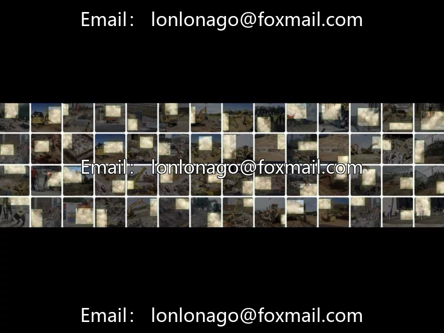
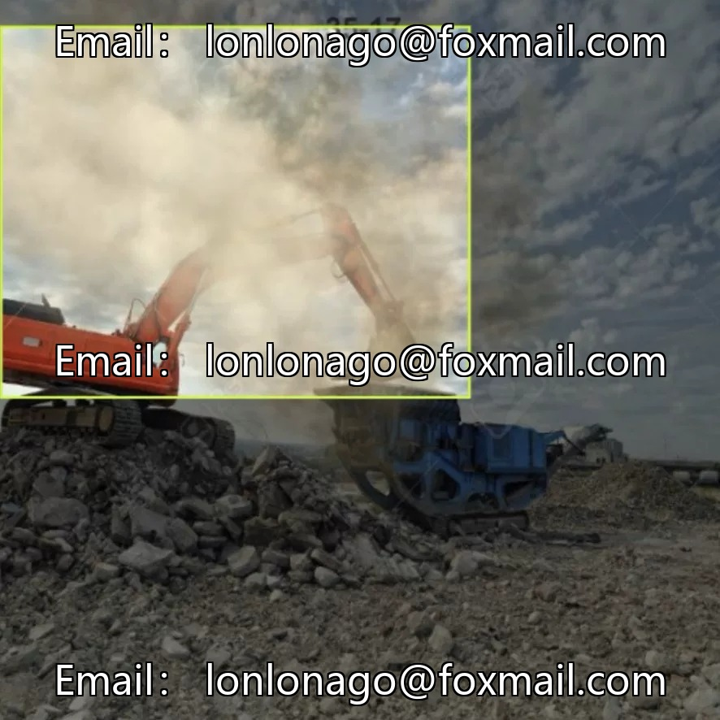
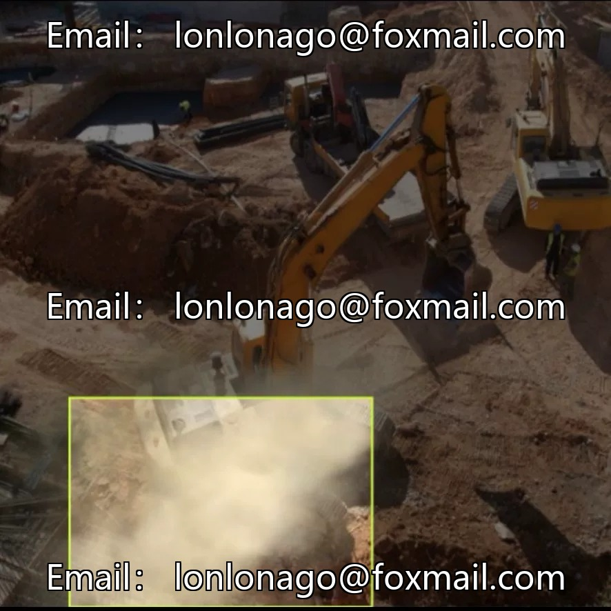
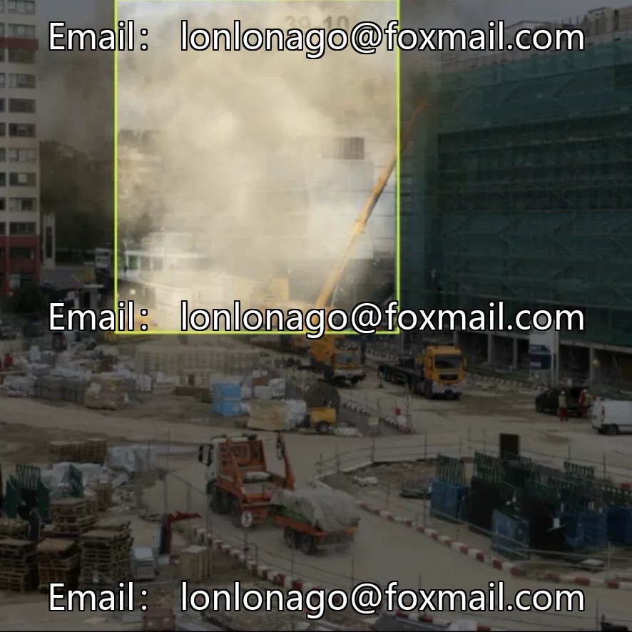
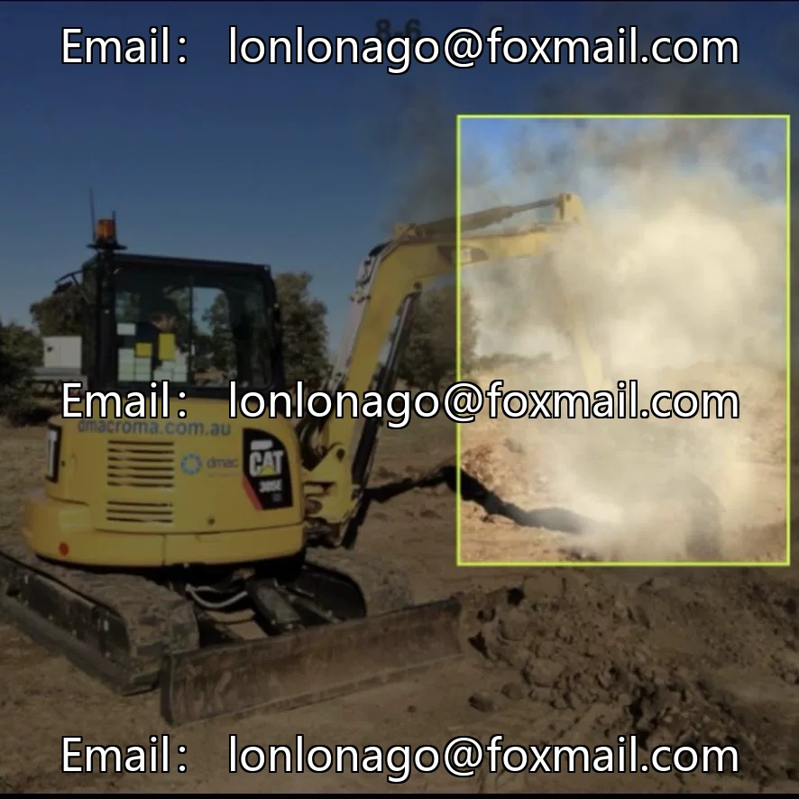
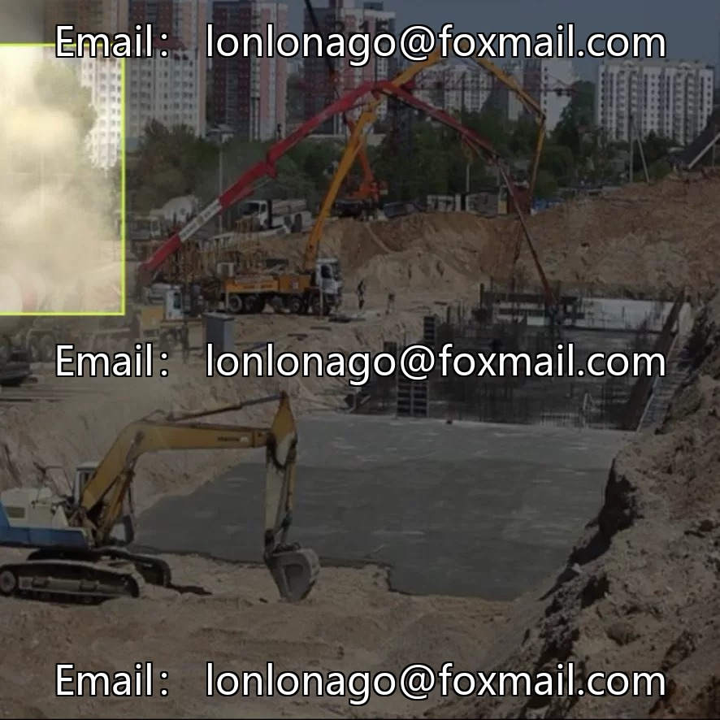

# Dust/dust target detection dataset, issue 10729

## Body

Dust/dust target detection dataset, issue 10729

The dataset contains over 3,800 images of industrial and construction scenes, focusing on the single target of "dust", suitable for scenarios such as environmental inspections, construction dust monitoring, pollution early warning system development, etc.

Task Type: Object Detection (Single-Class
Total Image Count: Over 3,800+
Number of Categories: 1 Category (Dust)
Annotation Format: YOLO format (.txt, with normalized bounding box coordinates
Data Partition: Providing training and validation splits

Format is friendly, directly used for training and inference of YOLOv26 series models, suitable for environmental protection inspection in industrial and construction scenarios, supports deployment to fixed surveillance or drone inspection systems, enhancing model generalization.

Virtual materials, once sold, are non-refundable.
Interested friends, click "I want" to proceed.

## Images

## Payment

Here is a pay link on Stripe ( https://buy.stripe.com/3cs8yP7sY87d0vu9AB ). Please contact me lonlonago@foxmail.com after funding $89, and I will send you a complete data files , thank you!

